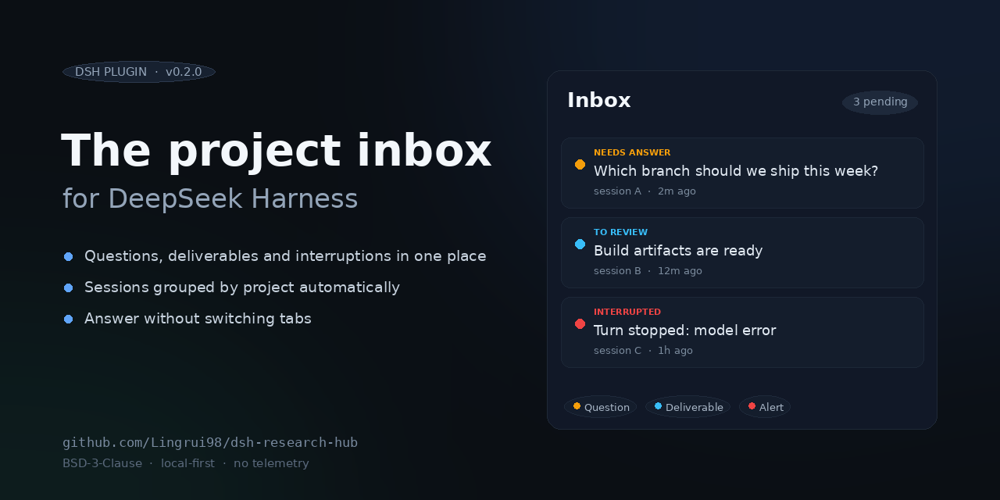
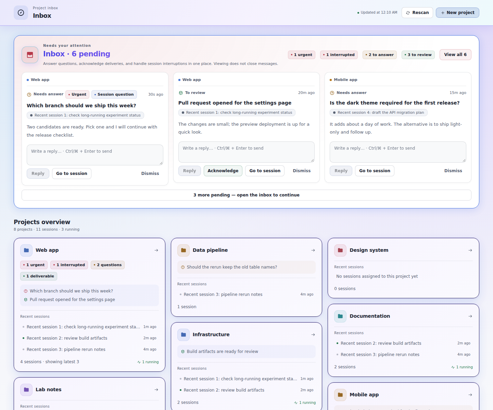

# DSH Project Inbox

[中文](README.md) | English

[](https://github.com/Lingrui98/dsh-project-inbox/releases/latest)
[](https://www.npmjs.com/package/dsh-project-inbox)
[](https://github.com/Lingrui98/dsh-project-inbox/actions/workflows/ci.yml)
[](LICENSE)

**One project inbox for DeepSeek Harness: collect the questions, deliverables and interrupted turns scattered across dozens of sessions, and act on them in place.**

DeepSeek Harness is great at getting one thing done, but not at keeping track of many things at once. Once sessions pile up, questions wait in a window you are not looking at, results end up in different places, and a failed turn may go unnoticed. Project Inbox adds a project view on top of DSH: sessions are attributed to projects automatically, everything that needs you lands in one inbox, and you handle it without switching tabs.

> An independent third-party plugin, not an official DeepSeek product. Current version **v0.3.0**, verified on **DSH 0.2.0-rc.2 Web profile**.



## Why it exists

- **Questions cannot find you.** A session is blocked waiting for an answer while you are working somewhere else.
- **Results are scattered.** A conclusion in session A, a deliverable in session B, a failure alert in session C — nothing brings them together.
- **Tidying up is manual.** With many sessions the sidebar turns into a log, and it is hard to tell which session belongs to which project or is still moving.

## Core capabilities

| Capability | What you get |
| --- | --- |
| **One inbox** | Questions waiting for you, deliverables waiting for review, and interrupted-turn alerts in one place, urgent items first. |
| **Automatic project attribution** | Your project folders are scanned and sessions are matched by title and first message; you only step in when a match is ambiguous. |
| **Act in place** | Answer, reply to continue a session, acknowledge or dismiss — without leaving the panel. |
| **No silent interruptions** | Model errors, crashes or restarts that stop a turn show up in the inbox; interruptions from before a restart are backfilled too. |
| **Opens instantly** | The panel renders from a local snapshot; opening it and polling stays in the millisecond range. |
| **Callable from outside** | CI, scripts or another machine can post results in; inbox events can be pushed to your own service. |
| **Your data stays local** | Single-file storage by default, no telemetry; switch to SQLite, and export/import any time. |



## How it differs

The DSH ecosystem already has session managers and notification plugins, each solving a slice. Project Inbox is positioned as a *project inbox*:

| | Session managers | Notifications | Project Inbox |
| --- | --- | --- | --- |
| Main job | Tidy, archive, delete sessions | Ping your screen or phone | Collect cross-session work that needs you |
| Aggregates pending work | No | Momentary reminder | Yes, persisted and actionable |
| Reply in place | No | No | Yes |
| Project attribution | Manual grouping | None | Inferred, lockable |
| External posting | No | No | Yes (off by default) |

## Quick start

### 1. Install

Install from npm (also available in the in-app plugin center):

```bash
dsh plugin --profile web add dsh-project-inbox
```

For offline or pinned installs, download the tarball from [Releases](https://github.com/Lingrui98/dsh-project-inbox/releases/latest) and install it locally:

```bash
dsh plugin --profile web add /absolute/path/to/dsh-project-inbox-0.3.1.tgz
```

The offline package ships prebuilt; no build step is needed. To verify:

```bash
sha256sum -c SHA256SUMS
```

### 2. Point it at your projects

The simplest setup is to give it a project root; its project directories become projects:

```yaml
- id: dsh-project-inbox
  name: 'dsh-project-inbox'
  config:
    projectsRoots:
      - /path/to/projects
```

A directory is treated as a project when it contains `.git` or `paper.toml` by default. If your projects use a different marker file (for example `package.json` or `Cargo.toml`), add one line of configuration instead of changing code.

### 3. Open the panel

Restart `dsh web`, refresh the page, and use the icon in the sidebar. After that just work as usual: questions appear in the inbox, and deliverables and interruptions arrive on their own.

## How it works

```text
project folders ──scan──▶ project list
   │
sessions ──attribution──▶ project
   │
   ├─ questions (including cross-session mirroring) ─┐
   ├─ deliverables posted by agents                 ─┼─▶ inbox ─▶ panel / tools / webhooks
   ├─ interrupted-turn alerts                       ─┤
   └─ posts from CI or scripts                      ─┘
```

No daemon and no changes to the DSH core: everything lives inside the plugin.

## Common configuration

| Option | Default | Meaning |
| --- | --- | --- |
| `projectsRoots` | empty | Fixed project discovery roots; falls back to the launch directory |
| `discovery.markers` | `["paper.toml", ".git"]` | Which files/directories mark a project |
| `discovery.maxDepth` | `1` | How many levels below each root to scan |
| `alertKinds` | `error` … | Which interruptions enter the inbox |
| `kinds` | three built-ins | Custom message types and how they are handled |
| `view` | default layout | Panel sections and grouping |
| `ingest.http.enabled` | `false` | Allow external systems to post |
| `webhooks` | empty | Push inbox events to your own service |
| `storage.driver` | `json` | Storage backend; may switch to `sqlite` |

See [docs/configuration.md](docs/configuration.md) for the full reference.

## Integrations

Post results from CI or a script (disabled by default; requires a token once enabled):

```bash
curl -fsS -X POST http://127.0.0.1:9999/rhub/api/post \
  -H "Authorization: Bearer $RHUB_INGEST_TOKEN" \
  -H 'Content-Type: application/json' \
  -d '{"type":"deliverable","title":"Build finished","body":"Artifacts: …","project":"my-project","idempotencyKey":"ci-20261022-1"}'
```

Push inbox events to your service (signed requests, retries, private addresses rejected by default):

```yaml
    webhooks:
      - url: https://example.com/rhub
        events: [item.created, item.urgent, alert.created]
        secret: change-me
```

## Data and privacy

- Data lives in a JSON file inside your local DSH profile; nothing is uploaded and there is no telemetry.
- The panel follows your DSH language setting (Chinese / English) and falls back to Chinese; refresh after changing it.
- External posting is off by default; when enabled it only accepts requests carrying a token and can be turned off at any time.
- Export and import are local endpoints for backup and migration.
- Export or back up `research-hub.json` before uninstalling (the file name keeps its historical name after the rename).

## Compatibility and limits

- Only DSH 0.2.0-rc.2 is verified; pre-release DSH interfaces may change.
- While a question is still inside its foreground waiting window, the panel may not be able to answer it — answer it in the session instead.
- Automatic attribution can be wrong; a manual binding locks the result.
- Published on npm; GitHub Releases provide offline tarballs with the same content.

## Development

Requires Node.js 24, npm, bash and an installed DSH:

```bash
git clone https://github.com/Lingrui98/dsh-project-inbox.git
cd dsh-project-inbox
npm ci --legacy-peer-deps --ignore-scripts
npm run build && npm run build:client
npm test
npm run test:package
```

The screenshots and social preview are rendered from the shipped client bundle with fictional demo data (no real inbox is read):

```bash
BROWSER_TEST_MODULE_ROOT=/path/to/package.json node scripts/social-preview.mjs
```

Run `npm run build:client` first and point it at a project with `react`, `react-dom`, `esbuild` and `playwright-core`.

## License

[BSD-3-Clause](LICENSE).
